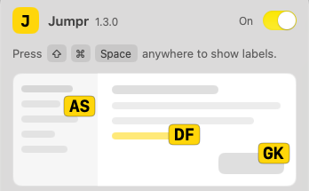
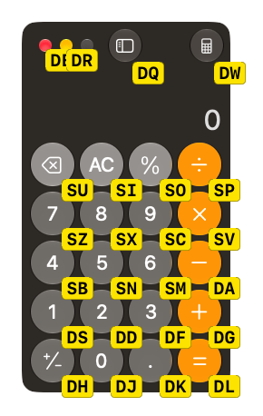

Jumpr needs macOS 15 or later. It works with one display or several.

## Install

1. [Download Jumpr.zip](https://github.com/ggoforth/jumpr/releases/latest/download/Jumpr.zip).
2. Unzip it and move Jumpr to your Applications folder.
3. Open Jumpr.

Jumpr lives in the menu bar and has no Dock icon. Click its menu bar icon to open [the panel](using/the-panel.md).

## Grant the permission

macOS asks for the Accessibility permission the first time you open Jumpr. Open System Settings → Privacy & Security → Accessibility and turn on Jumpr.

> **Can't find the setting?** Until you grant the permission, the panel has an Open Accessibility Settings button that takes you there.

[The Accessibility permission](help/accessibility.md) explains why Jumpr needs it and what it does with it.

## Click your first label

1. Press [[⌘]] [[⇧]] [[Space]]. Labels appear on every display.
2. Type the two letters of the label you want.
3. When the letters match, Jumpr clicks.

To close the labels without clicking, press [[Esc]].

## Where to go next

- [Labels and keys](using/labels-and-keys.md) lists every key that works while labels are up.
- [Kinds of click](using/kinds-of-click.md) shows how to right-click or double-click instead.
- [Scrolling](using/scrolling.md) covers scroll mode.
