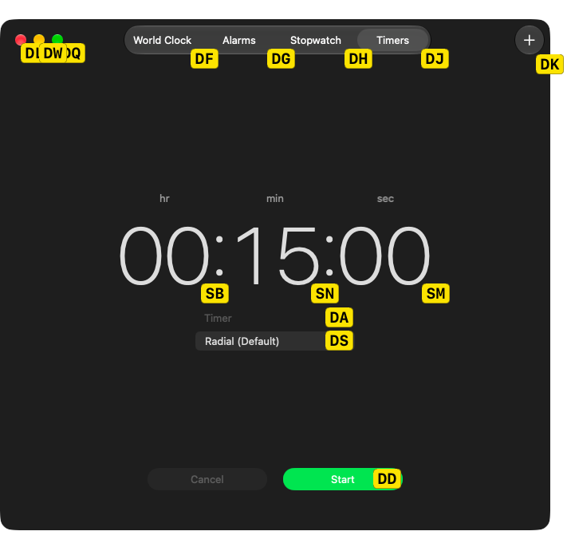

## Labels

- Widgets on the desktop have no labels.
- While Notification Center is open, windows behind it on that display have no labels, because a click outside it only closes it.
- Menu bar icons are found by remembering which apps own one. If an app adds its icon later, it has no label until Jumpr next checks: at unlock, when Jumpr resumes, or when an app launches or first comes to the front.
- A menu opened by a pop-up button or menu button gets no labels of its own. Use the arrow keys in it.
- A menu a web-based app draws itself gets no labels after a right-click, and nor does one that takes longer than a second to open.
- An element an app does not show to accessibility can't get a label.

## Keys

- While a password field has keyboard focus, macOS keeps keystrokes from reaching Jumpr, so neither the hotkey nor [[Esc]] works.
- While labels are up, [[⌘]], [[⌥]] or [[⌃]] with the letter that completes a label clicks instead of running that shortcut, unless that key's click is set to **None**.

## Web pages and web-based apps

- Web pages in a browser can take a moment to get their labels the first time, because browsers build that information on request. The labels arrive while the others are still up.
- A web-based app that was covered by other windows when Jumpr started gets its labels when the app first comes to the front. If you uncover it some other way, the first press may show few labels for it and the next is complete.
- Jumpr turns on accessibility information in web-based apps so it can see them. When you pause or quit, it turns off everything it turned on, including anything another tool had turned on too. If Jumpr loses the Accessibility permission while it runs, it can't turn them off, and they stay on until those apps quit.

## Persistent mode

- Changes made with the mouse or trackpad are not seen until the next label click, shortcut or [[Tab]].
- An element an app rebuilds gets new letters, even if it looks the same.
- Labels cover the page while you read it.

## Scroll mode

- Every area gets a letter, including ones with nothing to scroll. Picking one does nothing.
- Scroll mode scrolls up and down only.
- A web-based app may show no areas until you have pressed the label hotkey once.
