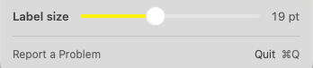

## Open an issue

Open an issue on [GitHub](https://github.com/ggoforth/jumpr/issues). Contributions are welcome. There is no promise about how fast anyone replies.

> ⚠️ **Security problems go privately.** Don't open a public issue. Follow [SECURITY.md](https://github.com/ggoforth/jumpr/blob/main/SECURITY.md) instead.



## The log

Jumpr keeps a small activity log on your Mac:

```
~/Library/Logs/Jumpr.log
```

An older copy, `Jumpr.log.1`, may sit beside it.

### What it has

- Timings
- The names of the apps Jumpr looked at
- For each press, the kind of control, the kind of click and the app
- For each scroll in scroll mode, the app and the amount

### What it doesn't have

- Window contents
- Text on screen
- Anything you type

The log stays on your Mac.

> ⚠️ **It names your apps.** If you attach the log to an issue, it shows which apps you had open. Issues are public.
