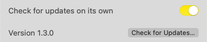

## How it works

Once a day, Jumpr checks an update feed on getjumpr.app to see whether a new version is out. When one is, Jumpr installs it when you say so. The update itself downloads from GitHub.

When an update is ready, Jumpr either shows the update window straight away or puts a dot on its menu bar icon. With the dot, open the panel to find a banner that says An update is ready, with an Install button.

## Turn it off, or check now

Both are on the panel's **General** tab:

- Turn off whether Jumpr checks for updates on its own.
- Click Check for Updates… to check now.

## What it sends

Checking for updates, and downloading one, is the only thing the app uses the internet for. The server sees your IP address and standard request details, such as a user agent naming Jumpr and its version.

The [privacy policy](https://getjumpr.app/privacy) has the full details.
