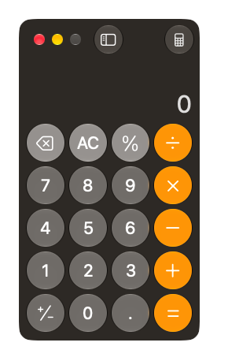

Press [[⌘]] [[⇧]] [[Space]] and Jumpr puts a short label, usually two letters, on every clickable element on every display: buttons, links, Dock icons, menu bar icons, menus and notifications. Type the letters and Jumpr clicks that element. Labels take about a tenth of a second to appear.

Jumpr is free and open source, from BaggaDonuts LLC. It needs macOS 15 or later.

## Start here

1. [Download Jumpr.zip](https://github.com/ggoforth/jumpr/releases/latest/download/Jumpr.zip) and move Jumpr to your Applications folder.
2. Open Jumpr and grant it the [Accessibility permission](help/accessibility.md).
3. Press [[⌘]] [[⇧]] [[Space]], then type the letters of a label.

[Getting started](getting-started.md) walks through each step.

## Find your way

| Page | What it covers |
|---|---|
| [Labels and keys](using/labels-and-keys.md) | Picking a label, and the keys that work while labels are up |
| [Kinds of click](using/kinds-of-click.md) | Right-click, ⌘-click, double-click and ⇧-click |
| [Persistent mode](using/persistent-mode.md) | Keeping labels up for a run of clicks |
| [Scrolling](using/scrolling.md) | Scrolling any area from the keyboard |
| [The panel](using/the-panel.md) | The settings under the menu bar icon |
| [Known limits](help/known-limits.md) | What Jumpr cannot label or click yet |
