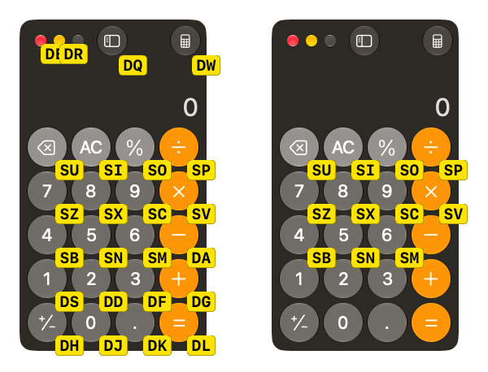

## Pick a label

1. Press [[⌘]] [[⇧]] [[Space]]. Labels appear on every display.
2. Type the letters of the label you want. Each letter you type hides the labels that don't match.
3. When the letters match, Jumpr clicks.

Labels are letters only. All the labels on screen at once have the same length, usually two letters.

When you pick a menu in the menu bar, its menu opens with labels of its own, so you can keep going without pressing the hotkey again.

> **Holding a key types it once.** A label like `AA` takes two taps.

You can change the hotkey on the panel's **Shortcuts** tab. See [The panel](the-panel.md).

## Keys while labels are up

| Key | What it does |
|---|---|
| [[Backspace]] | Undoes the last letter |
| [[Esc]] | Cancels |
| The hotkey again | Cancels |
| [[Space]] | Turns [persistent mode](persistent-mode.md) on, or off again |
| [[Tab]] | In persistent mode, updates the labels after a change you made with the mouse |

Any other key without [[⌘]], [[⌃]] or [[⌥]] is held back and does not reach the app.

## Shortcuts still work

Keys with [[⌘]], [[⌃]] or [[⌥]] pass through to the app, so your shortcuts keep working while labels are up.

> ⚠️ **One exception.** On the letter that completes a label, holding just one of [[⌘]], [[⌥]] or [[⌃]] picks a [kind of click](kinds-of-click.md) instead of running the shortcut, unless that key's click is set to **None**.
