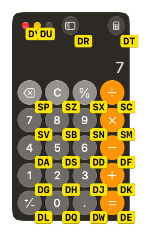

Without persistent mode, every click takes one press of the hotkey. With it on, one press of the hotkey carries the whole run.

## Turn it on

While labels are up, press [[Space]]. Press [[Space]] again to turn it off.

While it is on, the menu bar icon is shown filled. Each press of the hotkey starts with persistent mode off.

## What changes

After each click, the labels stay up and update to match what the click changed. Things that did not change keep their letters, and the menu bar, toolbars and other apps stay labelled while a page reloads.

Jumpr also updates the labels after a shortcut you press, such as [[⌘]] [[T]].

Changes you make with the mouse or trackpad are not seen. Press [[Tab]] to update the labels after one. Press [[Tab]] too when a page takes a long time to load.

## What ends it

- [[Esc]]
- Clicking into a text field, so you can type in it
- Clicking a button that opens a menu, so the arrow keys go to the menu
- A right-click
- A password field taking the keyboard focus soon after a click, a shortcut or [[Tab]]. Later than that, the labels stay up, and [[Esc]] can't reach Jumpr until focus leaves the field

> ⚠️ **A field opened another way keeps the labels up.** A search icon that opens a field, or [[⌘]] [[L]], leaves persistent mode on. Press [[Esc]], then type.
