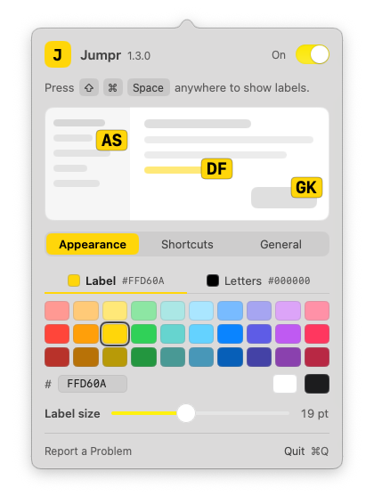
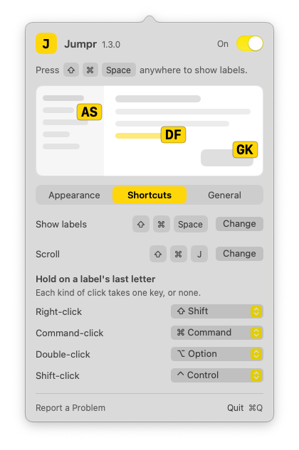
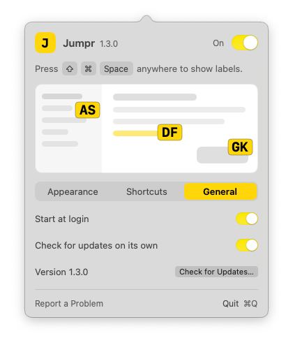

Click Jumpr's menu bar icon to open the panel. A click anywhere else closes it.

## At the top

- **The switch** turns Jumpr on and off. Off is a pause: the hotkey does nothing.
- **The preview** shows how your labels look.

## The three tabs

| Tab | What it holds |
|---|---|
| **Appearance** | Label color, letter color and label size |
| **Shortcuts** | The hotkey, the scroll shortcut, and the key for each kind of click |
| **General** | Start at login, whether Jumpr checks for updates on its own, and Check for Updates… |

### Appearance

One palette serves both colors. Choose Label or Letters above it, then a color. Auto letters are black or white, whichever reads better on the label.

### Shortcuts

A shortcut must include [[⌘]], [[⌃]] or [[⌥]]. For each [kind of click](kinds-of-click.md), choosing a key another click already has swaps the two.

> ⚠️ **Keep the two shortcuts different.** If the hotkey and the scroll shortcut are the same, the hotkey wins and scroll mode can't be reached.

### General

Start at login is off until you turn it on. [Updates](../help/updates.md) explains the update check.

## At the bottom

- **Report a Problem.** See [Reporting a problem](../help/reporting-a-problem.md).
- **Quit** closes Jumpr.
